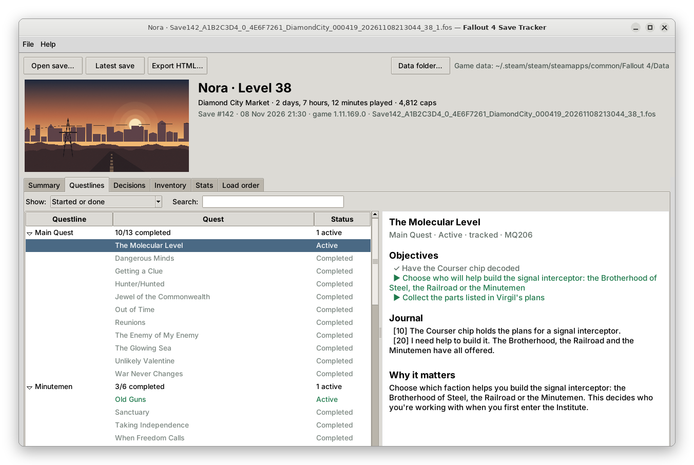
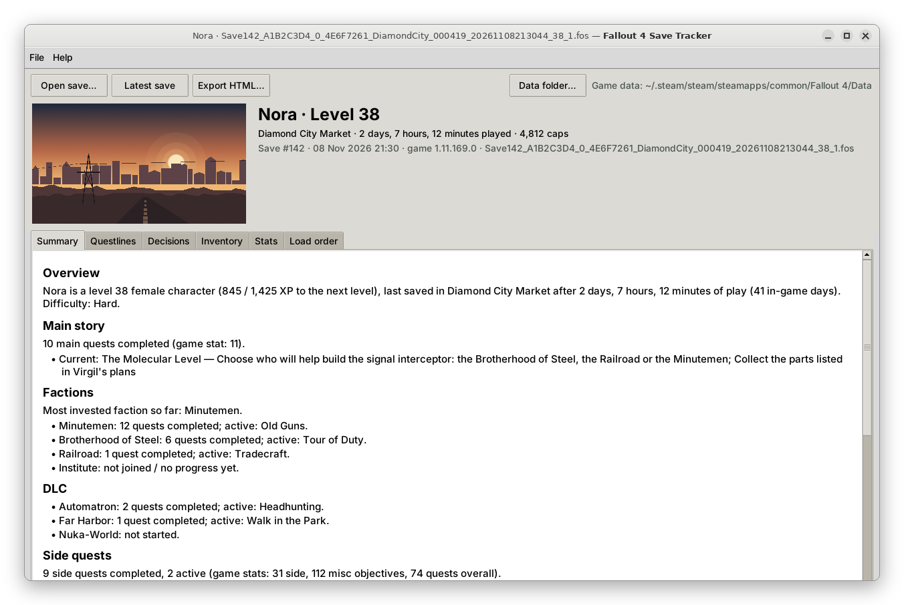
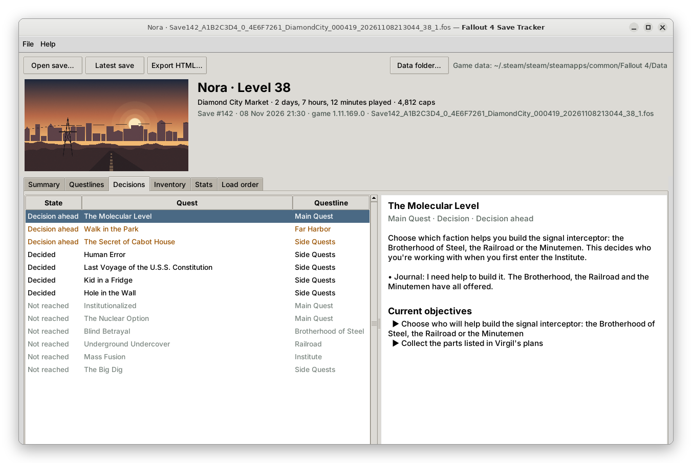
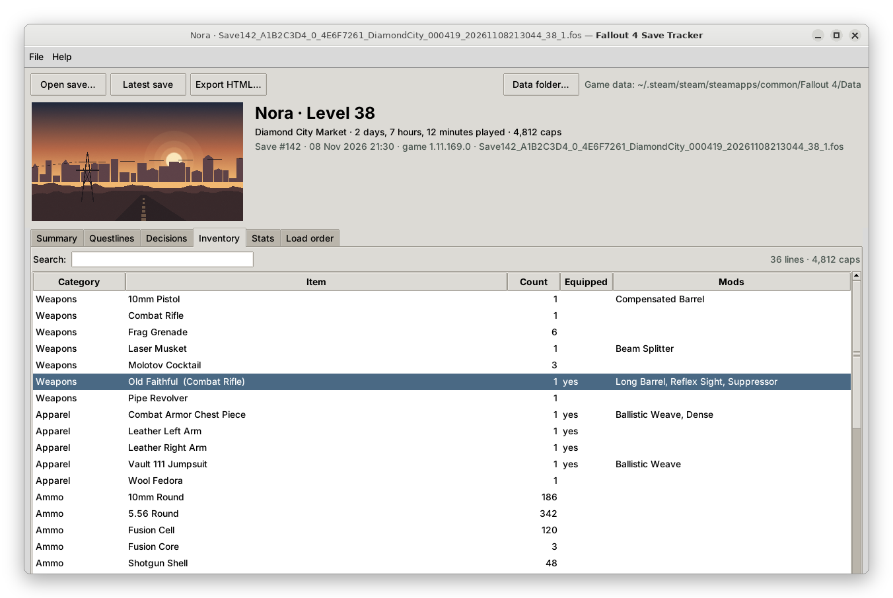
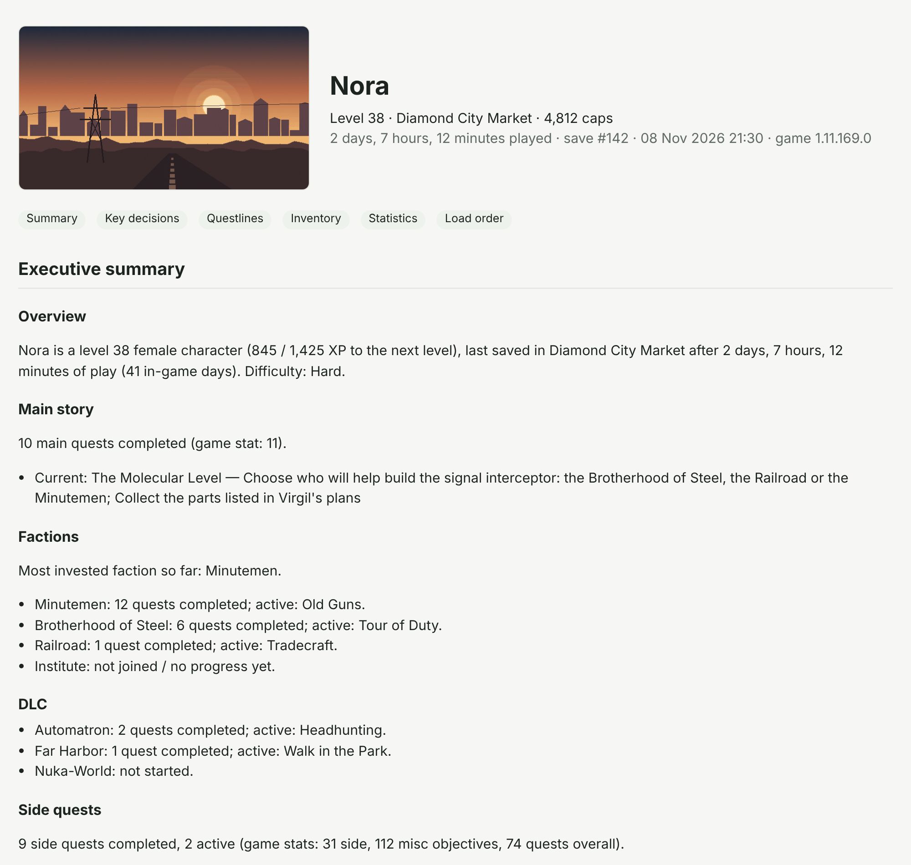

# Fallout 4 Save Tracker

Open a Fallout 4 save (`.fos`) and see where your playthrough stands: an executive summary,
every questline with its status, objectives and journal entries, the key story decisions
you've made or are about to make, your inventory, and your stats.

- **Read-only.** It never modifies your saves or game files.
- **No dependencies.** Pure Python 3 standard library plus Tkinter for the window.
- **Works offline** on Linux (including Steam/Proton) and Windows. On other systems, it can read
  saves you copy over.
- **Window, terminal, or HTML.** Use the desktop window, print a text report, or export a
  standalone HTML page you can keep or share.

<p align="center">
  
</p>
<p align="center"><sub>Screenshots use a made-up demo save.</sub></p>

> Fallout 4 Save Tracker is an unofficial fan project. It is not affiliated with or endorsed by
> Bethesda Softworks, ZeniMax Media or Microsoft. *Fallout* is a trademark of its owner.

## What you get

| Tab / section | What it shows |
|---|---|
| **Summary** | Level, playtime, difficulty, main-story position, faction progress, DLC, side quests, key decisions, inventory highlights and play-style stats, in plain sentences |
| **Questlines** | Every quest grouped by questline (Main, Minutemen, Brotherhood, Railroad, Institute, DLC, side, misc, Creation Club, mods), with status, objectives and journal entries. Filter and search are built in |
| **Decisions** | Story choices marked *decided*, *in progress* or *coming up*, with points of no return flagged, so you can make a backup save before them |
| **Inventory** | Every item, including custom names, attached weapon/armor mods and equipped state |
| **Stats** | All of the game's misc stats |
| **Load order** | Plugins in the save, any missing from your Data folder, the F4SE co-save version and any parser warnings |

### Screenshots

<table>
  <tr>
    <td width="50%"><a href="docs/images/gui-summary.png"></a>
      <p align="center"><b>Summary</b>: the whole playthrough at a glance</p></td>
    <td width="50%"><a href="docs/images/gui-decisions.png"></a>
      <p align="center"><b>Decisions</b>: what's settled and what's coming</p></td>
  </tr>
  <tr>
    <td width="50%"><a href="docs/images/gui-questlines.png"></a>
      <p align="center"><b>Questlines</b>: objectives and journal entries</p></td>
    <td width="50%"><a href="docs/images/gui-inventory.png"></a>
      <p align="center"><b>Inventory</b>: custom names, mods and equipped gear</p></td>
  </tr>
</table>

## Requirements

- Python 3.9 or newer
- Tkinter (for the window only; `--text` and `--html` work without it)
- Optional: [`tkinterdnd2`](https://pypi.org/project/tkinterdnd2/) to drag and drop saves onto the window
- Optional but recommended: a Fallout 4 install, for quest names, objective text, journal entries and
  item names (see [Game data](#game-data))

| Platform | Install Python + Tkinter |
|---|---|
| Debian / Ubuntu | `sudo apt install python3 python3-tk` |
| Fedora | `sudo dnf install python3 python3-tkinter` |
| Arch | `sudo pacman -S python tk` |
| Windows / macOS | The installers from [python.org](https://www.python.org/downloads/) include Tkinter |

## Install and run

From a clone of this repository:

```bash
python3 -m fo4tracker                 # open the window
```

Or install it so the `fo4tracker` command is on your PATH:

```bash
pipx install .                        # or: python3 -m pip install --user .
fo4tracker                            # open the window
fo4tracker-gui                        # same, without a console window on Windows
```

## Usage

### The window

- **Latest save** (Ctrl+L) opens your newest save automatically.
- **Open save…** (Ctrl+O) opens a specific save. You can also drop a `.fos` file on the window if
  `tkinterdnd2` is installed.
- **Data folder…** points the tool at `…/Fallout 4/Data`. Standard Steam installs are detected
  automatically.
- **View report in browser** (Ctrl+B) or **Export HTML…** (Ctrl+E) produces a standalone report page.
- **F5** reloads the current save. This is handy after you save again in-game.
- Click a column heading to sort it, and click it again to reverse the order.

### The HTML report

**Export HTML…** (or `--html FILE` on the command line) writes a single self-contained page,
with the save's thumbnail embedded. You can keep it, print it or share it. It follows your
system's light or dark mode.

<p align="center">
  <picture>
    <source media="(prefers-color-scheme: dark)" srcset="docs/images/report-dark.png">
    
  </picture>
</p>

### The command line

```bash
fo4tracker --latest --text                                  # newest save, printed
fo4tracker "Save89_….fos" --html report.html                # export a report
fo4tracker "Save89_….fos" --text --data "/path/to/Fallout 4/Data"
fo4tracker --help
```

| Option | Meaning |
|---|---|
| `SAVE` | The `.fos` file to read. Without `--text`/`--html` it opens in the window |
| `--latest` | Use your most recent save instead of naming one |
| `--text` | Print a plain-text report to stdout |
| `--html FILE` | Write a standalone HTML report |
| `--data DIR` | Your Fallout 4 `Data` folder, if it isn't detected |
| `--no-cache` | Don't read or write the game data cache |
| `--version` | Print the version |

Progress and warnings go to stderr. The exit code is `0` on success and `1` if the save can't be
read, so the tool is easy to script.

### Where saves are found

| Setup | Folder searched |
|---|---|
| Linux, Steam/Proton | `<Steam library>/steamapps/compatdata/377160/pfx/drive_c/users/steamuser/Documents/My Games/Fallout4/Saves` |
| Windows | `Documents\My Games\Fallout4\Saves` (and the OneDrive copy) |

Steam libraries are discovered from `libraryfolders.vdf`, including Debian's
`~/.steam/debian-installation`, Flatpak and Snap installs.

## Game data

A save stores only numbers: quest IDs, stage numbers and objective states. The names and text
live in the game's own files. When you point the tool at your `Data` folder, it reads
`Fallout4.esm`, the DLC and Creation Club plugins, and the string tables inside the `.ba2`
archives.

- **With game data** you get the full picture: every quest name, objective text, journal entry and item name.
- **Without game data** you still get stats, the inventory (with common items named), main and faction
  quest names, and statuses.

The first run reads the plugins, which takes a minute or so. The results are then cached per plugin in
`~/.cache/fo4tracker` (`%LOCALAPPDATA%\fo4tracker` on Windows), and the cache refreshes on its own when a plugin
changes. **File ▸ Clear game data cache** forces a full re-read.

## Key decisions

The tool ships with a starter list of important story choices: the faction points of no return,
the endings, Danse, Covenant, the U.S.S. Constitution, Cabot House and more. Each one is shown
as **decided**, **in progress** or **coming up**. "Coming up" means the quests that lead into it are done.
The tool also flags any active quest whose current objectives read like a choice.

You can add your own decisions (for example, for mod quests) in
`~/.config/fo4tracker/decisions.json` (`%APPDATA%\fo4tracker\decisions.json` on Windows):

```json
{"decisions": [
  {"edid": "DLC03MQ06", "line": "Far Harbor", "kind": "decision",
   "about": "Decide the island's future.", "after": ["DLC03MQ05"]}
]}
```

See [docs/decisions.md](docs/decisions.md) for the format.

## Documentation

- [docs/architecture.md](docs/architecture.md): how the code is organised and how data flows
- [docs/save-format.md](docs/save-format.md): the parts of the `.fos` format this tool decodes
- [docs/game-data.md](docs/game-data.md): plugins, string tables and BA2 archives
- [docs/decisions.md](docs/decisions.md): the decisions file format
- [docs/troubleshooting.md](docs/troubleshooting.md): common problems and fixes

## Limitations

- Tested on Anniversary Edition saves (game 1.11.x). Saves from earlier versions use the same
  layout apart from the light-plugin list, which the tool handles.
- The save layout for inventory extras was reverse-engineered. If a save contains an item format
  the tool doesn't know, it skips that item's extra details and says so instead of failing.
- When a journal stage has several alternative log lines, the tool shows the first one and marks
  it "one of several versions".
- "Equipped" comes from an inventory flag. Quest status combines the save's completed and failed
  flags with the plugin's "complete quest" log flags.
- Only English string tables are read by default.

## Development

```bash
python3 -m unittest discover -s tests            # full suite, no game files needed
xvfb-run -a python3 -m unittest discover -s tests   # include the GUI smoke test on headless Linux
FO4_TEST_SAVE=/path/to/save.fos python3 -m unittest discover -s tests   # + real-save checks
```

The tests build tiny synthetic saves, plugins, string tables and BA2 archives on the fly, so they
cover the whole pipeline without any copyrighted game files. See [CONTRIBUTING.md](CONTRIBUTING.md).

## License

[MIT](LICENSE)
